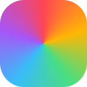
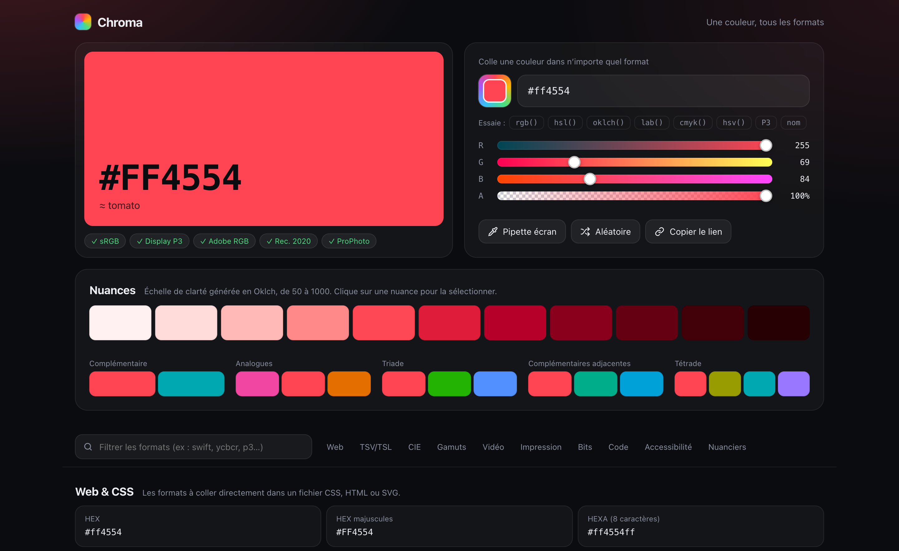
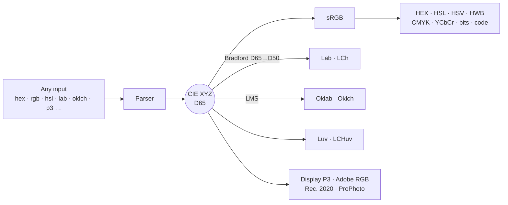

<div align="center">



# Chroma

**One color, every format.**

A fast, zero-dependency color converter that turns any color into **100+ representations**,
from everyday web formats to video, print and wide-gamut color spaces.

[](LICENSE)


<br>

<picture>
  <source media="(prefers-color-scheme: dark)" srcset="docs/screenshot-dark.png">
  <source media="(prefers-color-scheme: light)" srcset="docs/screenshot-light.png">
  
</picture>

</div>

<br>

## Table of contents

- [Features](#features)
- [Getting started](#getting-started)
- [Supported formats](#supported-formats)
- [Accepted inputs](#accepted-inputs)
- [How it works](#how-it-works)
- [Using the engine in your own code](#using-the-engine-in-your-own-code)
- [What is not converted, and why](#what-is-not-converted-and-why)
- [Project structure](#project-structure)
- [Browser support](#browser-support)
- [License](#license)

## Features

|  |  |
|---|---|
| 🎯 **Paste anything** | HEX, `rgb()`, `hsl()`, `hwb()`, `lab()`, `oklch()`, `color(display-p3 …)`, CMYK, HSV, CSS names, decimal integers, `vec4(…)`… The format is detected automatically. |
| 🖌️ **Three ways to pick** | Native color picker, RGB + alpha sliders, and a screen eyedropper. |
| 📋 **One click to copy** | Every one of the 100+ values is a button. |
| 🌈 **Wide-gamut aware** | Colors outside sRGB stay exact internally, are previewed in Display P3 when your screen supports it, and are flagged with gamut badges. |
| 🎨 **Palette tools** | An 11-step shade scale (50 → 1000) and five color harmonies, all generated in Oklch. |
| ♿ **Accessibility** | WCAG 2.x contrast ratios against white and black, graded AA / AAA. |
| 🔗 **Shareable** | The current color is stored in the URL. Send the link and the color comes with it. |
| 🔍 **Searchable** | Filter every format instantly: `swift`, `ycbcr`, `p3`… |
| 🌓 **Light & dark** | Follows your system theme. |
| 🔒 **100% local** | No build step, no tracking, no network requests. |

## Getting started

No install, no build. Clone the repository and open the page:

```bash
git clone https://github.com/LBasil/Chroma.git
cd Chroma
open index.html            # macOS · use `start index.html` on Windows, `xdg-open` on Linux
```

### Deploy to GitHub Pages

1. Push the repository to GitHub.
2. Go to **Settings → Pages**.
3. Under **Build and deployment**, choose **Deploy from a branch**, select `main` and `/ (root)`, then save.

Your converter will be live at `https://lbasil.github.io/Chroma/` within a minute.
Any other static host (Netlify, Vercel, Cloudflare Pages) works the same way.

## Supported formats

<details open>
<summary><b>Web & CSS</b> (24)</summary>

HEX · uppercase HEX · HEXA (8 digits) · short HEX `#RGB` · short HEXA `#RGBA` · `rgb()` · `rgba()` · modern `rgb(r g b / a)` · `rgb()` in % · normalized RGB / RGBA (0–1) · decimal integer · `hsl()` · `hsla()` · modern `hsl()` · `hwb()` · CSS named color (exact or nearest) · `color(srgb …)` · `color-mix()` (lighten, darken, transparency) · CSS custom property · Tailwind arbitrary value · SCSS variable
</details>

<details>
<summary><b>Hue-based models</b> (5)</summary>

HSV / HSB · HSB raw values · HSL raw values · HSI · HWB raw values
</details>

<details>
<summary><b>CIE & perceptual spaces</b> (12)</summary>

CIE XYZ (D65) · `color(xyz-d65)` · CIE XYZ (D50) · `color(xyz-d50)` · CIE xyY · CIELAB `lab()` · CIE LCh `lch()` · CIELUV · CIE LCHuv · Oklab `oklab()` · Oklch `oklch()` · correlated color temperature (K)
</details>

<details>
<summary><b>RGB gamuts</b> (10)</summary>

sRGB · linear sRGB · Display P3 · P3-D65 (γ 2.6, cinema) · Adobe RGB (1998) · Rec. 709 · Rec. 2020 · ProPhoto RGB · Display P3 and Adobe RGB in 0–255
</details>

<details>
<summary><b>Video & broadcast</b> (10)</summary>

YCbCr BT.601 (full range / JPEG and studio range) · YCbCr BT.709 (studio and full range) · YCbCr BT.2020 · YPbPr · YUV (PAL) · YIQ (NTSC) · YCoCg · Rec. 709 luma Y′
</details>

<details>
<summary><b>Print</b> (5)</summary>

CMYK (%) · `cmyk()` · `device-cmyk()` · CMYK (0–1) · total ink coverage
</details>

<details>
<summary><b>Bit depth & storage</b> (18)</summary>

1-bit monochrome · grayscale (luminance, Rec. 601 luma, average) · RGB332 · web-safe (216) · ANSI 256 (xterm) · RGB565 · RGB555 · ARGB1555 · ARGB4444 · True Color 24-bit · Deep Color 30-bit and 36-bit · 48-bit (decimal and hex) · 32-bit linear float (EXR) · binary
</details>

<details>
<summary><b>Code & languages</b> (20)</summary>

Decimal integer · `0xRRGGBB` · `0xAARRGGBB` · `0xRRGGBBAA` · Android XML · normalized floats · Swift UIKit · SwiftUI · SwiftUI Display P3 · Jetpack Compose · Flutter · Unity `Color` · Unity `Color32` · GLSL / HLSL · Java AWT · C# / .NET · Python · Matplotlib · ANSI truecolor escape · LaTeX `\definecolor`
</details>

<details>
<summary><b>Accessibility</b> (4)</summary>

Relative luminance · contrast with white · contrast with black · recommended text color
</details>

## Accepted inputs

Type or paste into the main field. All of these work:

```text
#ff4554                     ff4554                      #f45                  #ff455480
rgb(255 69 84)              rgba(255, 69, 84, .5)       255, 69, 84           16729428
1, 0.27, 0.33               vec4(1.0, 0.27, 0.33, 1.0)
hsl(355 100% 64%)           hsv(355, 73%, 100%)         hwb(355 27% 0%)
cmyk(0%, 73%, 67%, 0%)
lab(57.6% 70.3 39.4)        lch(57.6% 80.6 29.3)
oklab(66.6% 0.21 0.09)      oklch(66.6% 0.228 22.5)
color(display-p3 1 0 0.3)   color(rec2020 0.8 0.2 0.2)  color(xyz-d65 0.4 0.2 0.1)
tomato                      rebeccapurple               transparent
```

Anything else your browser understands as a CSS color is accepted through a canvas fallback.

> [!NOTE]
> A number made only of digits, like `16729428`, is read as a decimal integer. To enter a hex code made only of digits, keep the `#`: `#123456`.
> Three plain values like `1, 0, 0` are read as 0–255. Add a decimal point to use the 0–1 scale: `1.0, 0, 0`.

## How it works

Every color is stored as **CIE XYZ (D65) + alpha**. Each input is converted to XYZ, and every output is derived from it. Values are never clamped internally, so wide-gamut colors survive round trips.



- Matrices, white points and transfer functions follow [CSS Color Module Level 4](https://www.w3.org/TR/css-color-4/).
- Lab and LCh use the D50 white point, like CSS. Luv uses D65.
- Oklab follows [Björn Ottosson's definition](https://bottosson.github.io/posts/oklab/).
- Shades and harmonies reduce Oklch chroma until the color fits in sRGB, so the hue never shifts.
- When a color is outside sRGB, web formats show the clipped value and a badge tells you so.

## Using the engine in your own code

`js/convert.js` has no dependencies and exposes a global `Color` object. Load `js/names.js` first if you want CSS named colors.

```html
<script src="js/names.js"></script>
<script src="js/convert.js"></script>
<script>
  const { xyz, alpha } = Color.parse('oklch(70% 0.15 200)');

  Color.fromXyz('srgb', xyz);         // [r, g, b] in 0–1 (may exceed 0–1 if out of gamut)
  Color.fromXyz('display-p3', xyz);   // also: 'srgb-linear', 'a98-rgb', 'rec2020', 'prophoto-rgb'
  Color.xyzToLab(xyz);                // [L, a, b]
  Color.polar(Color.xyzToOklab(xyz)); // [L, C, H]  (Oklch)
</script>
```

## What is not converted, and why

Some color terms do not describe a computable color, so Chroma does not invent values for them.

| Term | Why |
|---|---|
| **Pantone, RAL, NCS, Munsell, DIC, TOYO** | Proprietary physical swatch libraries. No formula maps a HEX value to them; they require licensed lookup tables. |
| **ICC profiles** | They describe one specific device. The CMYK shown here is a profile-free mathematical conversion, not a press-accurate one. |
| **Bayer filter** | A camera sensor's capture process, not a color format. |
| **Chroma subsampling** (4:4:4, 4:2:2, 4:2:0) | Applies to groups of pixels, not to a single color. |

## Project structure

```
.
├── index.html          Markup (the interface is in French)
├── style.css           Styles, light and dark themes
├── js/
│   ├── names.js        The 148 CSS named colors
│   ├── convert.js      Conversion engine and input parser
│   └── app.js          UI: state, rendering, palette, events
└── docs/               README assets
```

## Browser support

Works in every modern browser (Chrome, Edge, Firefox, Safari).

| Feature | Support |
|---|---|
| Screen eyedropper | Chromium only (Chrome, Edge, Opera). The button is disabled elsewhere. |
| Wide-gamut preview | Needs a P3-capable display and browser (Safari, Chrome). Falls back to sRGB. |

## License

Released under the [MIT License](LICENSE).
